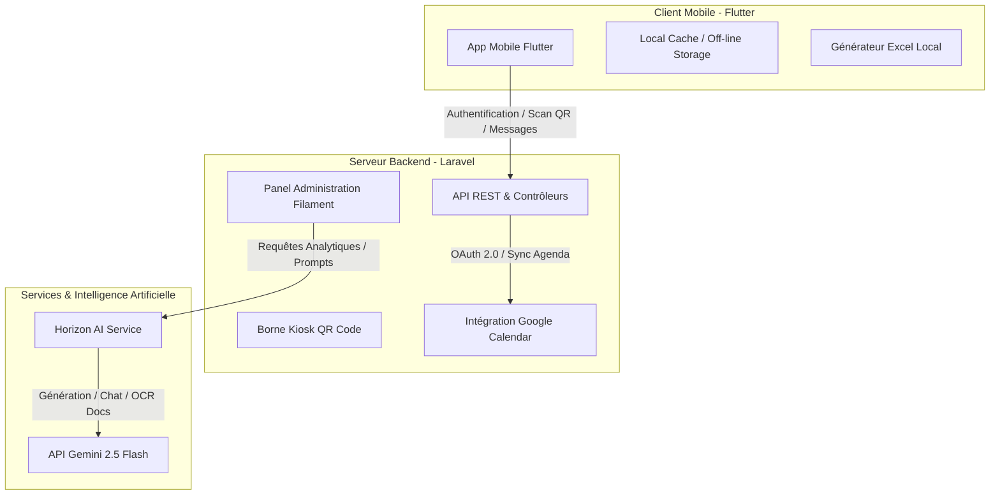

# Cahier des Charges - Projet C.H.R.A.C.E.R.H
## Application Web et Mobile de Gestion de Présences des Employés

---

## 1. Introduction et Contexte
Le projet **C.H.R.A.C.E.R.H** est une solution moderne de gestion des présences, des retards, des absences et de la communication interne pour les employés et le service des Ressources Humaines (RH). 

Ce système repose sur une synergie entre :
1. Une **borne de pointage Web (Kiosk)** affichant un code QR dynamique.
2. Une **application mobile (Flutter)** permettant aux employés de badger via leur smartphone en scannant le QR code de la borne, de gérer leurs rapports locaux et de communiquer avec le service RH.
3. Un **portail d'administration Web (Laravel Filament)** offrant aux responsables RH un tableau de bord, des statistiques d'assiduité, un calendrier d'événements synchronisé et un assistant intelligent (**Horizon AI**) reposant sur l'IA générative Gemini pour automatiser la détection des anomalies, l'analyse des justificatifs et la prédiction de l'absentéisme.

---

## 2. Objectifs du Projet
* **Automatisation du pointage :** Éliminer le pointage manuel sur papier ou via des feuilles d'émargement physiques peu fiables.
* **Fiabilisation des données :** Réduire les risques de fraude et de fausses déclarations de présence grâce au pointage par code QR.
* **Simplification administrative pour les RH :** Générer automatiquement des rapports d'assiduité réguliers et fiables (au format Excel/PDF).
* **Analyse prédictive et détection intelligente :** Identifier automatiquement les anomalies (doubles scans, contradictions), prévoir les risques d'absentéisme à l'aide de l'IA (modèle XGBoost et Gemini) et traiter les justificatifs d'absence de manière semi-automatisée.
* **Fluidification de la communication interne :** Offrir un canal d'échange direct entre chaque employé et le service RH pour la soumission et la justification des absences.

---

## 3. Architecture Technique du Système

Le système est conçu autour de trois composants principaux :

### 3.1. Stack Technique
* **Frontend Web (Administration & Kiosk) :** PHP 8.2+, Laravel 10/11, Filament PHP (interface d'administration réactive), TailwindCSS / Vanilla CSS, Livewire.
* **Application Mobile :** Flutter (Dart) pour Android & iOS, base de données locale (SharedPreferences & Cache JSON), package `excel` pour la génération locale de rapports.
* **Intelligence Artificielle & Traitement de données :** 
  * API **Google Gemini 2.5 Flash** (pour le traitement du langage naturel, l'analyse des pièces jointes OCR, l'assistant conversationnel Horizon, les prédictions d'absentéisme et les résumés d'anomalies).
* **Base de données :** MySQL ou PostgreSQL.
* **Intégrations tierces :** API Google Calendar (pour le calendrier RH partagé) et PhpSpreadsheet (génération de rapports Excel sur le serveur).

---

## 4. Fonctionnalités Détaillées

### 4.1. L'Application Web d'Administration (Laravel Filament)
L'interface d'administration est réservée aux gestionnaires RH et aux administrateurs. Elle comprend les modules suivants :

#### A. Tableau de Bord RH (Dashboard)
* Affichage en temps réel des statistiques journalières (nombre de présents, d'absents, de retards).
* Graphiques d'assiduité comparatifs inter-départements (générés dynamiquement).
* Liste des derniers pointages effectués sur la borne Kiosk.

#### B. La Borne Kiosk (`/kiosk`)
* Interface web publique affichée sur une tablette ou un écran à l'entrée de l'entreprise.
* Génération ou affichage d'un identifiant/QR code pour le scan.
* Affichage en direct du flux des derniers pointages réussis ("Pointages récents") pour rassurer les employés lors de leur passage.

#### C. Gestion des Employés
* Fiches individuelles des employés (Nom, prénom, matricule, département, rôle, contact).
* Rôles utilisateurs : `RH_Admin`, `Manager`, `Employe`.

#### D. Calendrier RH (`/ressources-humaines/calendrier`)
* Intégration bidirectionnelle avec **Google Calendar**.
* Permet de planifier des réunions, des entretiens RH ou des congés, directement synchronisés avec l'agenda Google de l'organisation.

#### E. Messagerie Interne
* Réception des messages et des documents envoyés par les employés depuis l'application mobile.
* Possibilité d'envoyer des réponses, des notifications et d'annexer des fichiers (formulaires, décisions).

#### F. Module IA « Horizon »
Intégré sous forme de page interactive avec un agent conversationnel autonome :
* **Détection d'anomalies :** Identification des fraudes potentielles (ex: double scan le même jour, contradictions où un employé est marqué présent et absent simultanément, séries anormales de retards). Envoi d'alertes automatiques par e-mail aux administrateurs.
* **Prédiction des risques d'absentéisme :** Calcul d'un score de risque d'absence pour chaque employé sur la base de son historique récent (30 derniers jours), de son ancienneté et des tendances de la semaine.
* **Analyse de documents par IA (Gemini) :** Import d'un justificatif (ex: certificat médical, arrêt de travail). L'IA extrait le nom, le motif et les dates de validité. Si le justificatif est valide, **Horizon met à jour automatiquement les absences** dans la base de données en les marquant comme présences justifiées.
* **Interface conversationnelle vocale et textuelle :** Commandes rapides pour générer des rapports (journalier, hebdomadaire, mensuel, annuel) exportables en Excel ou PDF.

---

### 4.2. L'Application Mobile (Flutter)
L'application mobile est l'outil quotidien des employés. Elle est conçue avec une charte graphique sombre (Dark Mode) premium.

#### A. Connexion Simplifiée (Matricule)
* Pas de mot de passe complexe : connexion rapide via le **matricule unique** de l'employé.
* Une fois connecté, les données de profil et le jeton d'accès sont mis en cache localement (`SharedPreferences`).

#### B. Accueil et Statistiques (Home Tab)
* Affichage de l'heure courante synchronisée.
* Indicateur visuel d'assiduité globale (ex: "Assiduité excellente" en vert ou "À améliorer" en orange).
* Graphique circulaire (Donut) représentant la répartition des présences, retards et absences de l'employé sur les 30 derniers jours.
* Historique défilant des derniers pointages.

#### C. Pointage par Code QR (Scanner)
* Activation de la caméra du smartphone pour scanner le QR Code affiché sur la borne Kiosk de l'entreprise.
* Envoi instantané du pointage au serveur avec géolocalisation ou vérification de proximité (optionnel).
* Enregistrement en mode hors-ligne si le réseau est indisponible, avec synchronisation automatique ultérieure dès le retour de la connexion internet.

#### D. Gestion des Rapports (Reports Tab)
* **Génération de rapports Excel locaux (.xlsx) :** L'application mobile peut compiler l'historique des pointages stockés en local pour générer des rapports hebdomadaires détaillés directement sur l'appareil.
* Classement automatique des rapports dans des dossiers classés par mois (ex: Janvier, Février, etc.).
* Visualisation et partage des rapports générés.

#### E. Messagerie (Chat Tab)
* Messagerie instantanée directe avec le service RH.
* Envoi de messages texte et de fichiers joints (photos de justificatifs d'absence, certificats médicaux).
* Réception des réponses de l'administrateur RH.

---

## 5. Spécifications des Données et Modèles de Données

Le système repose sur un schéma de base de données structuré autour des entités suivantes :

### 5.1. Employés (`employes`)
* `id` (INT, Clé primaire)
* `matricule` (VARCHAR, Unique)
* `first_name` (VARCHAR)
* `last_name` (VARCHAR)
* `email` (VARCHAR, Unique)
* `role` (ENUM: 'RH_Admin', 'Manager', 'Employe')
* `department_id` (INT, Clé étrangère)
* `anciennete_mois` (INT)
* `created_at` / `updated_at` (TIMESTAMP)

### 5.2. Pointages (`pointages`)
* `id` (INT, Clé primaire)
* `employee_id` (INT, Clé étrangère)
* `date` (DATE) - *Date du pointage*
* `time` (TIME) - *Heure du pointage*
* `status` (ENUM: 'Present', 'Absent', 'Retard')
* `is_late` (BOOLEAN)
* `anomaly_detected` (BOOLEAN, par défaut false)
* `created_at` / `updated_at` (TIMESTAMP)

### 5.3. Rapports (`rapports`)
* `id` (INT, Clé primaire)
* `titre` (VARCHAR)
* `contenu` (TEXT)
* `date_rapport` (DATE)
* `employe_id` (INT, Clé étrangère) - *Créateur du rapport*
* `created_at` / `updated_at` (TIMESTAMP)

---

## 6. Analyse Prédictive de l'Absentéisme (Horizon AI)
Pour alimenter les prédictions d'absentéisme présentées par Horizon AI aux gestionnaires RH, l'application utilise un algorithme d'analyse comportementale basé sur l'historique de pointage des 30 derniers jours.

### Fonctionnement de la Prédiction :
Le système calcule un score de risque de récidive et d'absentéisme pour chaque employé selon des coefficients de pondération :
* **Pondération des retards :** Chaque retard enregistré au cours des 30 derniers jours augmente le score de risque (ex: +10% par retard).
* **Pondération des absences non justifiées :** Chaque jour d'absence non justifié augmente fortement le risque (ex: +25% par absence).
* **Niveaux de risque :**
  * **Critique (Score >= 60%) :** Assiduité fortement perturbée, entretien RH recommandé.
  * **Modéré (Score entre 30% et 59%) :** Quelques retards ou absences constatés, situation à surveiller.
  * **Faible (Score < 30%) :** Assiduité conforme et régulière.

Ces métriques sont ensuite interprétées par l'assistant Gemini pour formuler des recommandations RH concrètes et adaptées dans l'interface conversationnelle.

---

## 7. Sécurité et Gestion des Pannes (Mode Hors-ligne)
1. **Validation en ligne & locale :** Si le serveur API de C.H.R.A.C.E.R.H est inaccessible, l'application mobile Flutter bascule automatiquement en mode hors-ligne. Elle stocke les scans QR en local dans un gestionnaire de cache sécurisé.
2. **Synchronisation en arrière-plan :** Un service de synchronisation d'arrière-plan vérifie régulièrement la connectivité réseau et transmet les pointages en attente dès que la connexion est rétablie.
3. **Sécurité des scans :** Le code QR affiché sur la borne Kiosk intègre un jeton dynamique et temporaire (timestampé) afin d'éviter la fraude par copie d'écran ou partage de QR Code statique entre employés.
