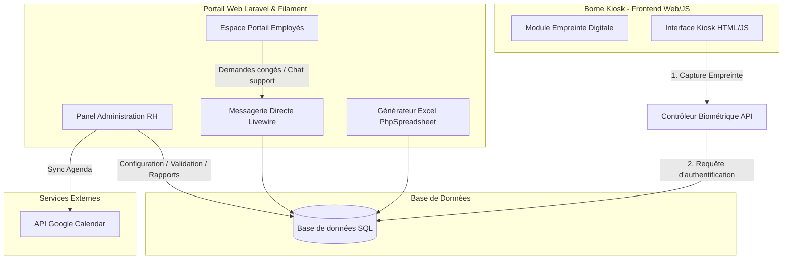

# Cahier des Charges - Projet C.H.R.A.C.E.R.H

## Système Intégré de Gestion des Présences et d'Accueil Biométrique - CHRACERH

---

## 1. Introduction et Contexte
Le projet **C.H.R.A.C.E.R.H** (Centre Hospitalier de Recherche et d'Application en Chirurgie Endoscopique et Reproduction Humaine) est une solution moderne et centralisée pour le suivi d'assiduité du personnel, la planification des ressources et l'orientation des patients lors de leur arrivée en consultation.

Ce système repose entièrement sur une architecture Web composée de :
1. **Un Portail Web (Laravel Filament PHP) :** Permet aux gestionnaires RH d'administrer le personnel, de gérer les congés/permissions, de suivre les rendez-vous, de générer des rapports d'assiduité mensuels et de chatter en direct avec les employés. Il permet également aux employés de se connecter pour consulter leur tableau de bord d'assiduité et d'envoyer leurs demandes de congés ou messages.
2. **Une Borne Interactive Kiosk (`/kiosk`) :** Affichée sur une tablette ou un écran mural à l'entrée de l'établissement. Elle prend en charge le pointage biométrique des employés (empreinte digitale) ainsi que l'enregistrement de présence des patients arrivant pour un rendez-vous médical.

> [!IMPORTANT]
> **Focus 100% Web (`crhacerh-web`) :** L'application mobile (`crhacerh-mobile`) a été officiellement isolée et retirée du flux actif d'exploitation. L'ensemble des fonctionnalités (gestion des présences, borne Kiosk de pointage, suivi des rendez-vous et rapports mensuels) est centralisé sur l'application Web Laravel / Filament PHP.

---

## 2. Objectifs du Projet
* **Fiabilisation biométrique du pointage :** Éliminer le pointage manuel sur papier ou par badge plastique (risques d'usurpation) grâce aux empreintes digitales.
* **Orientation et accueil des patients :** Enregistrer de manière autonome la présence d'un patient dès son arrivée à la borne pour notifier le médecin et fluidifier les files d'attente.
* **Simplification administrative pour les RH :** Génération automatique de rapports d'assiduité périodiques (fichiers Excel `.xlsx` classés dans des dossiers par mois), et traitement automatisé des demandes de congés.
* **Centralisation de la communication interne :** Chat d'assistance RH direct intégré permettant aux agents de soumettre leurs pièces justificatives numérisées.

---

## 3. Architecture Technique du Système

Le système est conçu autour de deux composants principaux :

### 3.1. Stack Technique
* **Serveur Backend & API :** PHP 8.2+, Laravel 11.2, Filament PHP 3.2 (Panel d'administration réactif), Livewire (composants dynamiques temps réel).
* **Base de données :** MySQL ou PostgreSQL.
* **Biométrie :** Lecteurs biométriques d'empreintes digitales (enregistrement et vérification des templates biométriques).
* **Génération de Rapports :** PhpSpreadsheet (génération de fichiers Excel `.xlsx` côté serveur et stockage hiérarchisé par mois).
* **Système de Messagerie :** Cmgmyr Messenger avec gestion d'attachements de fichiers.

---

## 4. Fonctionnalités Détaillées

### 4.1. Le Portail d'Administration RH (Filament PHP)

L'interface d'administration est structurée en plusieurs modules d'exploitation :

#### A. Tableau de Bord RH (Dashboard)
* Affichage en direct du nombre d'employés présents, d'absents et de retards pour la journée en cours.
* Calcul automatique de la tendance de présence par rapport au jour précédent.
* Graphique hebdomadaire de suivi d'assiduité (Chart.js) comparant les états (Présent, En retard, Absent).
* Tops 5 des employés les plus assidus, les plus en retard et les plus absents pour orienter les entretiens de réajustement.

#### B. Gestion des Employés
* CRUD des fiches individuelles (Matricule, nom, prénom, email, rôle, département, téléphone).
* Enregistrement des données biométriques (historique de consentement biométrique et statut des empreintes digitales).
* Attribution des rôles : `RH_Admin`, `Manager`, `Employés`.

#### C. Calendrier Institutionnel
* Intégration bidirectionnelle avec **Google Calendar** (OAuth 2.0).
* Planification et affichage des congés acceptés, réunions de service et planning de présence des médecins.

#### D. Messagerie de Support Direct
* Chat en temps réel permettant aux agents de communiquer avec les ressources humaines.
* Prise en charge de pièces jointes (photos de justificatifs, certificats d'arrêt maladie) pour une validation manuelle par les RH.

#### E. Gestionnaire des Rapports Mensuels
* Génération automatique ou manuelle de rapports au format Excel (`.xlsx`).
* Espace d'exploration interactif affichant les rapports classés dans des dossiers nommés par mois (ex : `Janvier 2026`, `Février 2026`).
* Téléchargement, consultation directe et suppression des rapports périodiques.

### 4.2. La Borne de Pointage Interactive Kiosk

La borne est accessible en plein écran sans authentification utilisateur permanente et comprend 3 onglets principaux :

#### A. Onglet Pointage des Présences
* Pointage en temps réel par **Empreinte Digitale** de l'employé.
* Flux dynamique des derniers pointages réussis du jour (assurance de la prise en compte du pointage).
* Affichage en alternance d'un QR code dynamique régénéré pour pointage rapide sécurisé.

#### B. Onglet Rendez-vous Patients du Jour
* Liste triée par heure des rendez-vous planifiés pour la journée.
* Permet au patient arrivant d'enregistrer sa présence par empreinte digitale pré-enregistrée.
* Met à jour le rendez-vous en statut "Présent" avec l'heure exacte d'arrivée, informant immédiatement le personnel soignant dans Filament.

#### C. Onglet Enregistrement Biométrique
* Permet aux employés ou patients de s'enregistrer pour la première fois (pose de l'empreinte sur le capteur).
* Les données capturées sont associées au matricule ou au dossier du patient dans la base de données après consentement.

---

## 5. Spécifications des Données et Modèles

### 5.1. Employés (`employés`)
* `id` (INT, Clé primaire)
* `matricule` (VARCHAR, Unique)
* `email` (VARCHAR, Unique)
* `password` (VARCHAR)
* `first_name` / `last_name` (VARCHAR)
* `role` (ENUM: 'RH_Admin', 'Manager', 'Employés')
* `department_id` (INT, Clé étrangère)
* `phone` (VARCHAR)
* `fingerprint_data` (TEXT) - Template de l'empreinte digitale
* `fingerprint_registered_at` (TIMESTAMP)

### 5.2. Pointages (`pointages`)
* `id` (INT, Clé primaire)
* `employee_id` (INT, Clé étrangère)
* `type` (ENUM: 'ENTREE', 'SORTIE')
* `status` (ENUM: 'Present', 'Absent', 'Retard')
* `source` (ENUM: 'EMPREINTE', 'QR')
* `timestamp` (TIMESTAMP)
* `confidence_score` (FLOAT)
* `anomaly_detected` (BOOLEAN)

### 5.3. Rendez-vous (`rendez_vous`)
* `id` (INT, Clé primaire)
* `nom_patient` (VARCHAR)
* `telephone_patient` / `email_patient` (VARCHAR)
* `service` / `motif` (VARCHAR)
* `date_rendez_vous` (TIMESTAMP)
* `medecin` (VARCHAR)
* `statut` (ENUM: 'Planifié', 'Confirmé', 'Réalisé', 'Reporté', 'Annulé', 'Présent')
* `fingerprint_data` (TEXT)
* `fingerprint_registered_at` (TIMESTAMP)
* `pointage_at` (TIMESTAMP)

### 5.4. Congés (`conges`)
* `id` (INT, Clé primaire)
* `employe_id` (INT, Clé étrangère)
* `type` (ENUM: 'Congé', 'Permission', 'Maladie')
* `date_debut` / `date_fin` (TIMESTAMP)
* `motif` (TEXT)
* `statut` (ENUM: 'En attente', 'Approuvée', 'Rejetée')
* `commentaire_rh` (TEXT)

---

## 6. Sécurité et Résilience
1. **Sécurisation des Données Biométriques :** Stockage crypté des templates d'empreintes digitales en base de données, sans enregistrement des images brutes d'empreintes.
2. **Consentement Biométrique (RGPD) :** L'enregistrement de l'empreinte est assujetti à la validation d'une case de consentement biométrique écrite, enregistrant la date et l'heure dans les profils.
3. **Sécurisation des Accès :** Le pointage physique par QR Code utilise des jetons dynamiques valables 10 secondes maximum pour prévenir les pointages frauduleux à distance par copie d'écran.
