# Recueil des Modèles et Diagrammes pour le Rapport de Stage
## Projet C.H.R.A.C.E.R.H 🚀

Ce document contient l'intégralité des diagrammes et modèles d'analyse, de conception et d'architecture demandés pour votre rapport de stage, structurés suivant vos 16 points clés. Ils sont rédigés en syntaxe **Mermaid** afin d'être rendus directement sous forme d'images PNG.

---

## I. Analyse des besoins et analyse métier

### 1. Diagramme de cas d'utilisation (Use Case Diagram)
Représente les acteurs du système (Employé, Administrateur RH, Manager) et leurs interactions avec les différentes fonctionnalités métier.

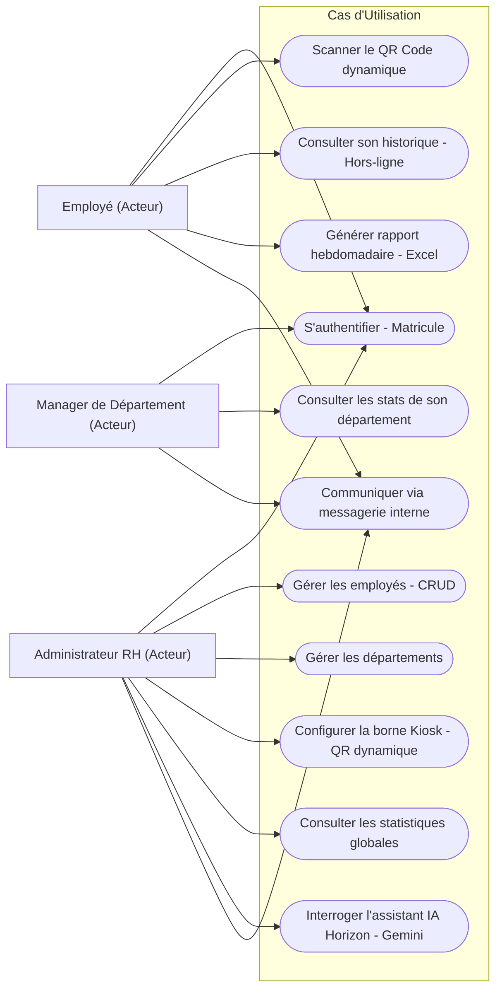

---

### 2. Diagramme d'activité (Activity Diagram)
Représente le déroulement logique et séquentiel du flux de pointage quotidien par l'employé sans géolocalisation.

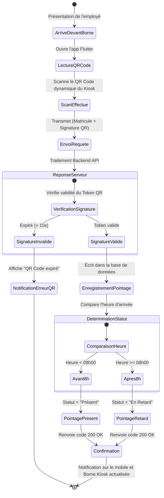

---

## II. Analyse détaillée

### 3. Diagramme de séquence (Sequence Diagram)
Montre chronologiquement les échanges détaillés de messages lors du processus de scan et d'enregistrement du pointage.

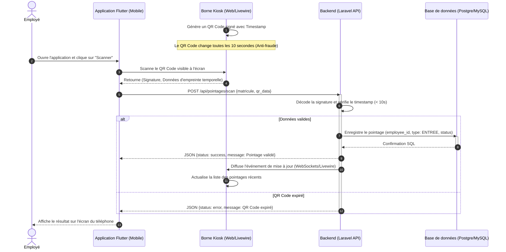

---

### 4. Diagramme de collaboration/communication
Illustre l'organisation spatiale des objets communicants et leurs relations dynamiques.

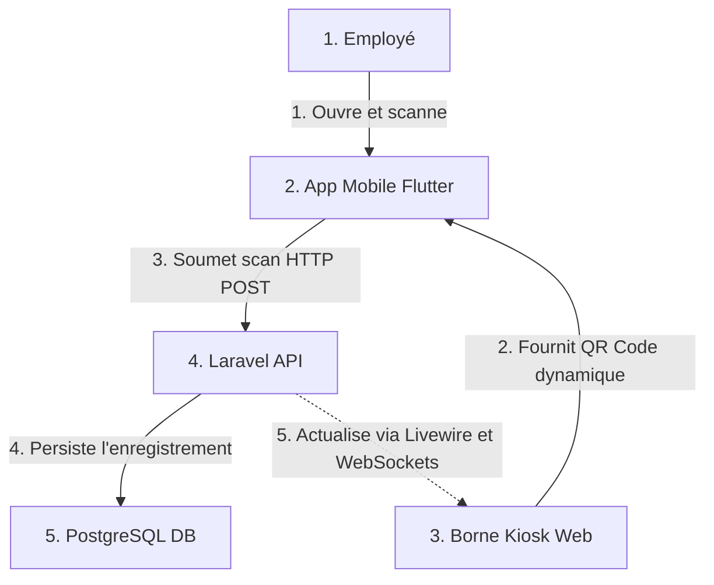

---

### 5. Diagramme d'état-transition (State Machine Diagram)
Décrit les états successifs d'un employé et d'un pointage au cours de leur cycle de vie.

#### État de l'Employé
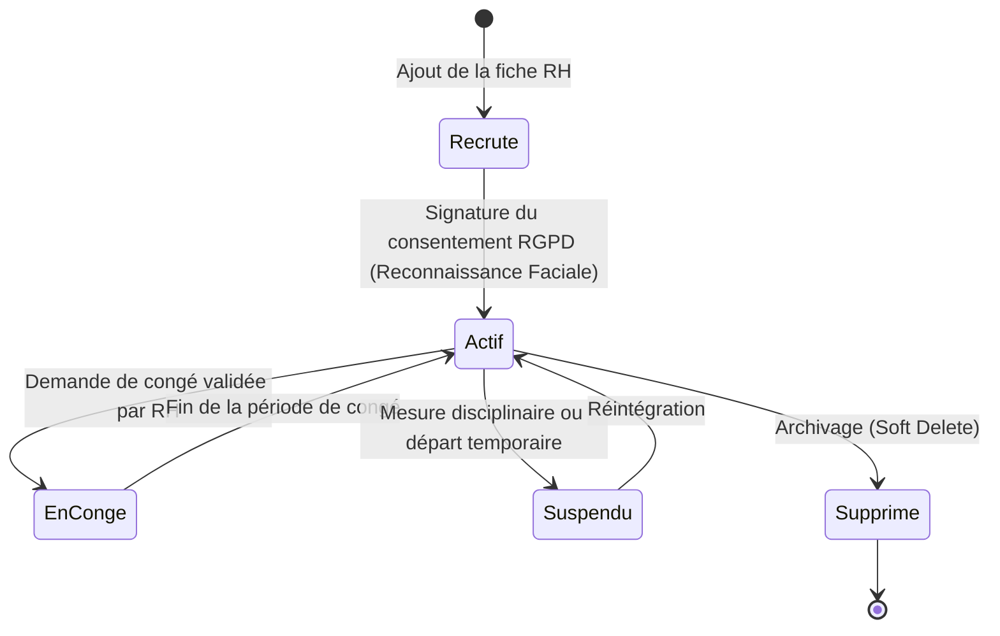

#### État d'un Pointage
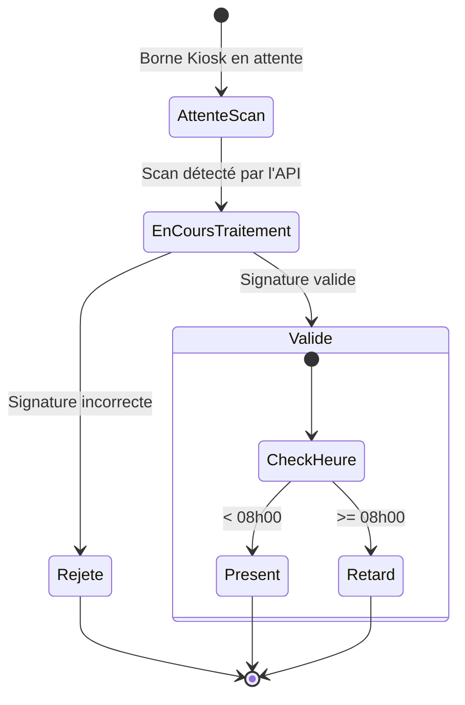

---

### 6. Diagramme d'activité détaillé
Représente l'activité de l'assistant IA Horizon (intégrant Gemini) lors du traitement et de l'analyse automatique des absences.

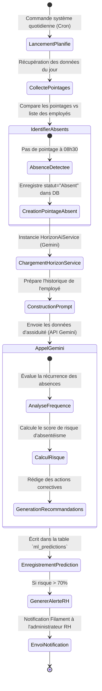

---

## III. Conception architecturale

### 7. Diagramme de composants (Component Diagram)
Montre l'organisation modulaire du système et ses interconnexions via l'API REST et les services tiers.

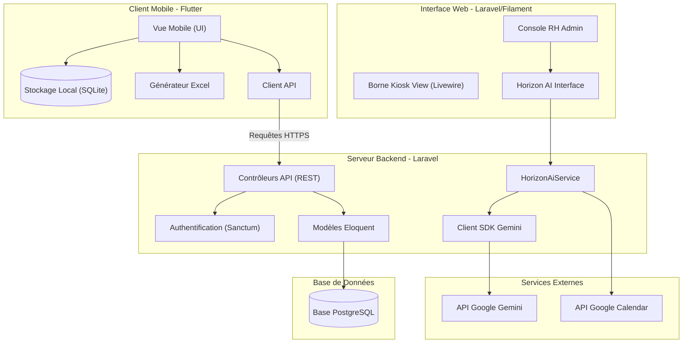

---

### 8. Diagramme de déploiement (Deployment Diagram)
Décrit la topologie matérielle d'exécution physique (smartphones, serveurs, base de données).

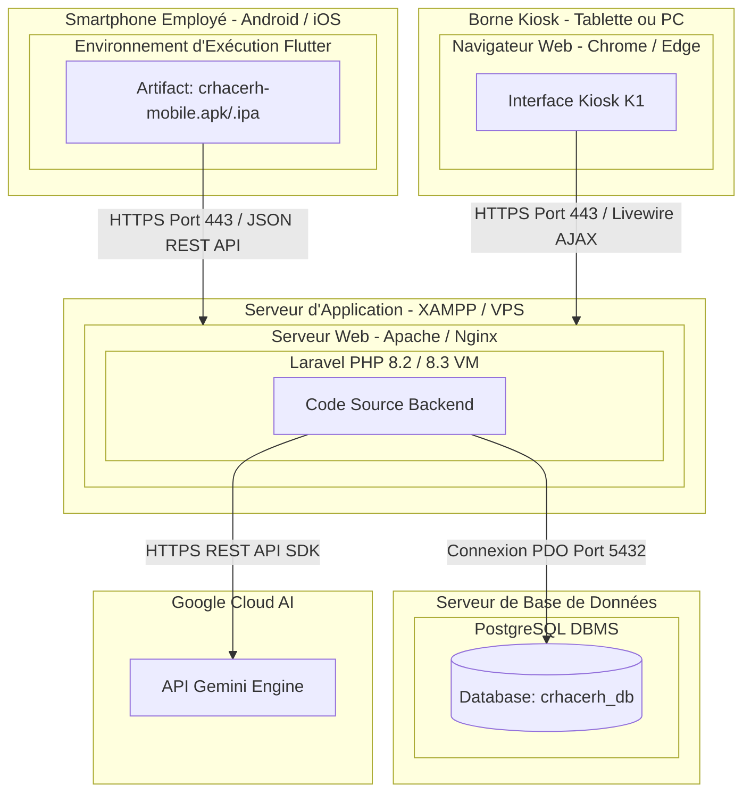

---

### 9. Diagramme de paquetages (Package Diagram)
Montre la structuration interne des répertoires du backend Laravel et du client mobile Flutter.

#### Paquetages Laravel (Backend)
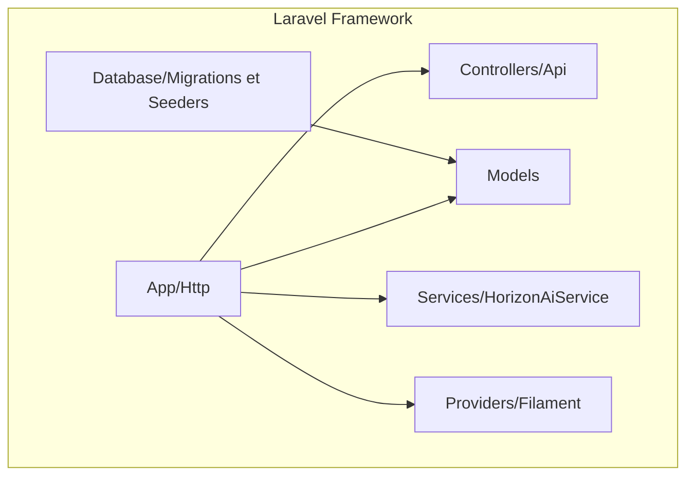

#### Paquetages Flutter (Mobile)
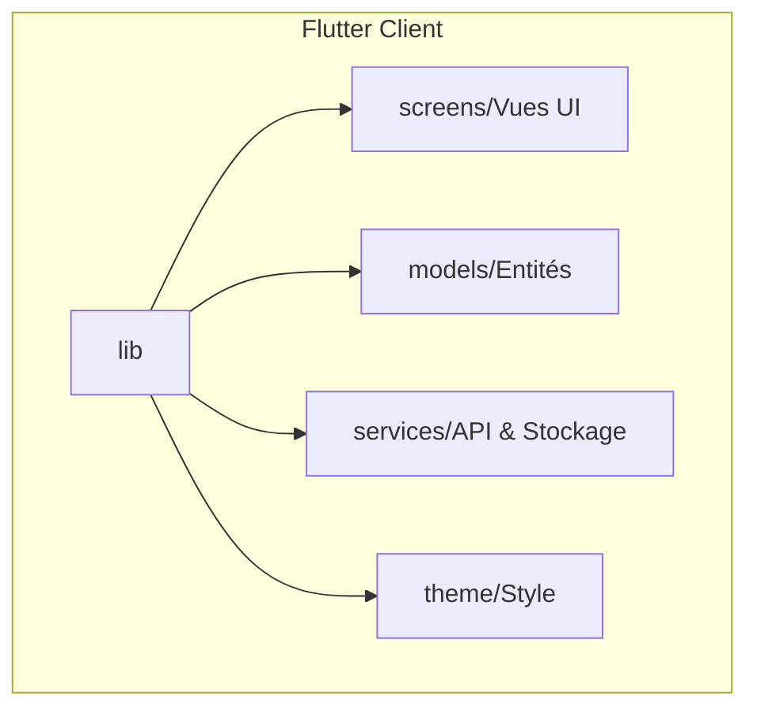

---

## IV. Conception détaillée

### 10. Diagramme de classes détaillé (Class Diagram)
Affiche les entités avec leurs attributs, types, méthodes, ainsi que leurs relations d'association et multiplicités.

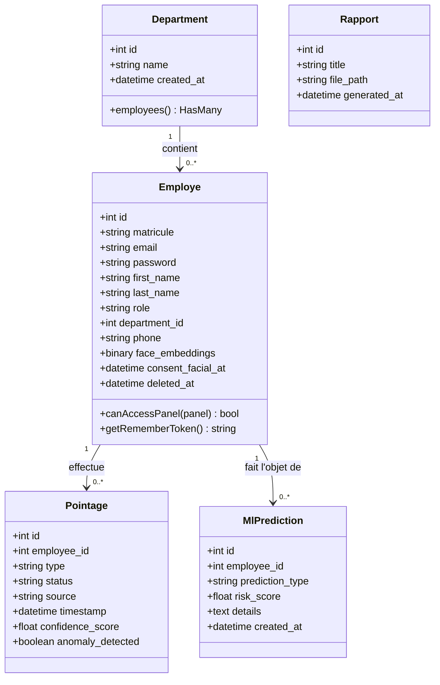

---

### 11. Diagramme d'objets (Object Diagram)
Donne un exemple d'instanciation des objets à un instant T pour illustrer le pointage d'un employé.

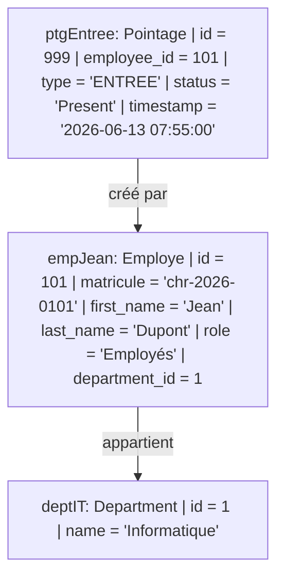

---

## V. Bases de données et Interface

### 12. Dictionnaire de données
Fournit une description rigoureuse de la structure de chaque champ de la base de données.

| Code / Nom du champ | Libellé / Description | Type | Taille | Règles / Contraintes |
| :--- | :--- | :--- | :--- | :--- |
| **EMP_ID** | Identifiant unique de l'employé | Entier (SERIAL) | | Clé primaire, Auto-incrémenté |
| **EMP_MAT** | Matricule unique de l'employé | VARCHAR | 50 | Unique (Format strict: `chr-20xx-xxxx`) |
| **EMP_EMAIL** | Email de connexion | VARCHAR | 150 | Unique, Format email valide |
| **EMP_PWD** | Mot de passe sécurisé | VARCHAR | 255 | Haché en base (Bcrypt) |
| **EMP_FN** | Prénom | VARCHAR | 100 | Obligatoire |
| **EMP_LN** | Nom de famille | VARCHAR | 100 | Obligatoire |
| **EMP_ROLE** | Rôle de l'utilisateur | VARCHAR | 50 | `Employés`, `Manager`, `RH_Admin` |
| **EMP_TEL** | Numéro de téléphone | VARCHAR | 20 | Optionnel |
| **EMP_EMB** | Empreintes biométriques faciales | BYTEA (Binary) | | Vecteur d'embeddings faciaux (128 dimensions) |
| **EMP_RGPD** | Date de consentement RGPD | TIMESTAMP | | Enregistre l'acceptation de la biométrie |
| **DEP_ID** | Identifiant du département | Entier (SERIAL) | | Clé primaire |
| **DEP_NOM** | Nom du département | VARCHAR | 100 | Unique |
| **PTG_ID** | Identifiant unique du pointage | Entier (SERIAL) | | Clé primaire |
| **PTG_TYP** | Type de pointage | VARCHAR | 20 | `ENTREE`, `SORTIE` |
| **PTG_STT** | Statut du pointage | VARCHAR | 20 | `Present`, `Retard`, `Absent` |
| **PTG_SRC** | Source du pointage | VARCHAR | 20 | `QR`, `FACE` (Reconnaissance Faciale) |
| **PTG_TS** | Date et heure du pointage | TIMESTAMP | | Rempli automatiquement à la transaction |
| **PTG_CONF** | Score de confiance faciale | DOUBLE | | Taux de correspondance (entre 0.0 et 1.0) |
| **PTG_ANOM** | Anomalie détectée | BOOLEAN | | `TRUE` si usurpation suspectée |

---

### 13. Schéma relationnel
Traduction logique de la structure de données prête pour l'implémentation.

*   **departments** (<u>id</u>, name, created_at, updated_at)
*   **employees** (<u>id</u>, matricule, email, password, first_name, last_name, role, phone, face_embeddings, consent_facial_at, created_at, updated_at, deleted_at, *department_id#*)
*   **pointages** (<u>id</u>, type, status, source, timestamp, confidence_score, anomaly_detected, created_at, updated_at, *employee_id#*)
*   **ml_predictions** (<u>id</u>, prediction_type, risk_score, details, created_at, *employee_id#*)
*   **rapports** (<u>id</u>, title, file_path, generated_at)

---

### 14. Schéma physique (scripts de création, index, optimisations)
Code SQL DDL optimisé pour PostgreSQL permettant la création physique des tables avec indexations stratégiques.

```sql
-- 1. Table départements
CREATE TABLE departments (
    id SERIAL PRIMARY KEY,
    name VARCHAR(100) NOT NULL UNIQUE,
    created_at TIMESTAMP WITHOUT TIME ZONE DEFAULT NOW(),
    updated_at TIMESTAMP WITHOUT TIME ZONE DEFAULT NOW()
);

-- 2. Table employés
CREATE TABLE employees (
    id SERIAL PRIMARY KEY,
    matricule VARCHAR(50) NOT NULL UNIQUE,
    email VARCHAR(150) NOT NULL UNIQUE,
    password VARCHAR(255) NOT NULL,
    first_name VARCHAR(100) NOT NULL,
    last_name VARCHAR(100) NOT NULL,
    role VARCHAR(50) DEFAULT 'Employés',
    department_id INTEGER REFERENCES departments(id) ON DELETE SET NULL,
    phone VARCHAR(20),
    face_embeddings BYTEA,
    consent_facial_at TIMESTAMP WITHOUT TIME ZONE,
    created_at TIMESTAMP WITHOUT TIME ZONE DEFAULT NOW(),
    updated_at TIMESTAMP WITHOUT TIME ZONE DEFAULT NOW(),
    deleted_at TIMESTAMP WITHOUT TIME ZONE
);

-- 3. Table pointages
CREATE TABLE pointages (
    id SERIAL PRIMARY KEY,
    employee_id INTEGER NOT NULL REFERENCES employees(id) ON DELETE CASCADE,
    type VARCHAR(20) NOT NULL,
    status VARCHAR(20) NOT NULL,
    source VARCHAR(20) DEFAULT 'QR',
    timestamp TIMESTAMP WITHOUT TIME ZONE NOT NULL,
    confidence_score DOUBLE PRECISION,
    anomaly_detected BOOLEAN DEFAULT FALSE,
    created_at TIMESTAMP WITHOUT TIME ZONE DEFAULT NOW(),
    updated_at TIMESTAMP WITHOUT TIME ZONE DEFAULT NOW()
);

-- Optimisations & Indexations
CREATE UNIQUE INDEX idx_employees_matricule ON employees(matricule);
CREATE INDEX idx_pointages_employee_ts ON pointages(employee_id, timestamp DESC);
CREATE INDEX idx_pointages_status ON pointages(status);
```

#### Diagramme du Schéma Physique (ERD)
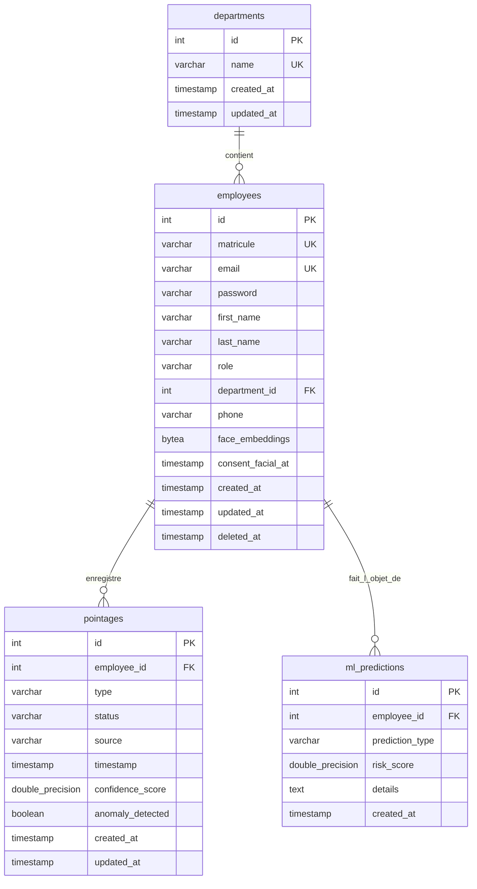

---

### 15. Diagrammes d'interface utilisateur (Maquettes/wireframes)
Représente la structure ergonomique de l'application mobile et du panel d'administration Web.

#### Écran d'accueil - Application Mobile Flutter
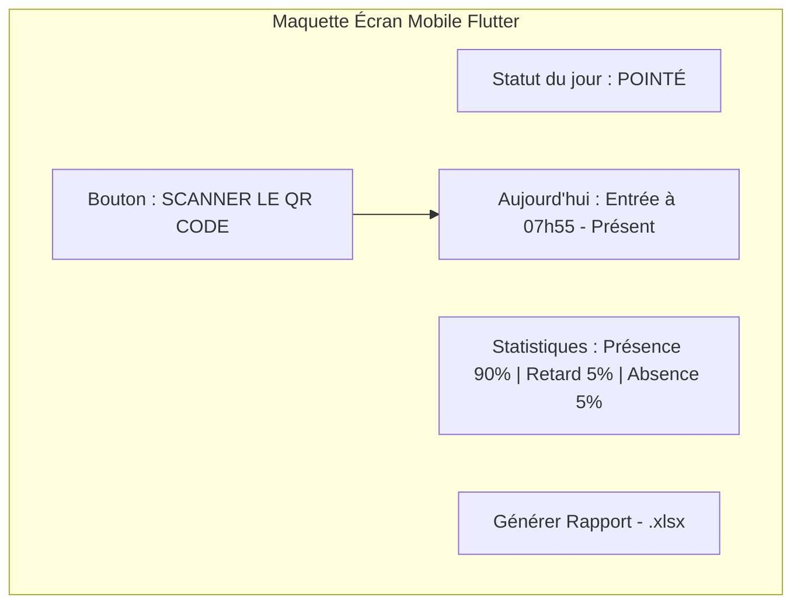

#### Écran Dashboard - Panel Administration Filament
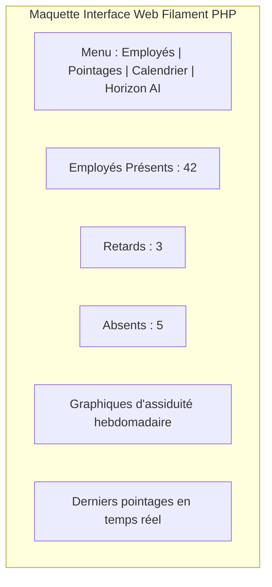

---

### 16. Architecture de l'application
Schéma d'architecture de type client-serveur suivant le patron MVC (Modèle-Vue-Contrôleur) pour le transfert de données.

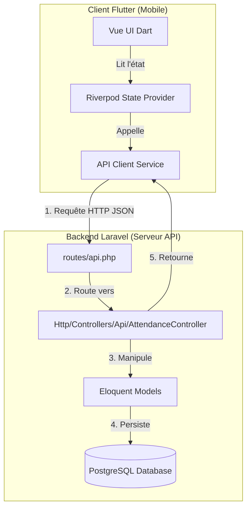
