# Recueil des Modèles et Diagrammes pour le Rapport de Stage - CHRACERH

## Projet : Système Intégré de Gestion des Présences et d'Accueil Biométrique - CHRACERH 🚀

Ce document contient l'ensemble des diagrammes et modèles d'analyse, de conception et d'architecture pour votre rapport de stage, mis à jour pour refléter une architecture **100% Web et Borne Kiosk, axée sur les empreintes digitales et QR codes** (sans intelligence artificielle ni reconnaissance faciale Gemini).

---

## I. Analyse des besoins et analyse métier

### 1. Diagramme de cas d'utilisation (Use Case Diagram)
Représente les acteurs du système (Employé, Patient, Administrateur RH, Manager) et leurs interactions avec les composants logiciels.

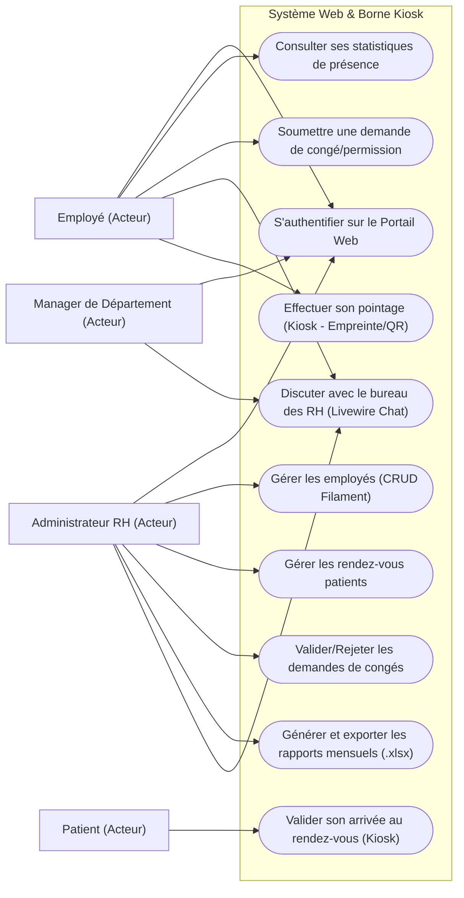

---

### 2. Diagramme d'activité (Activity Diagram)
Représente le flux de pointage quotidien d'un employé sur la borne interactive Kiosk par empreinte digitale ou par scan de code QR.

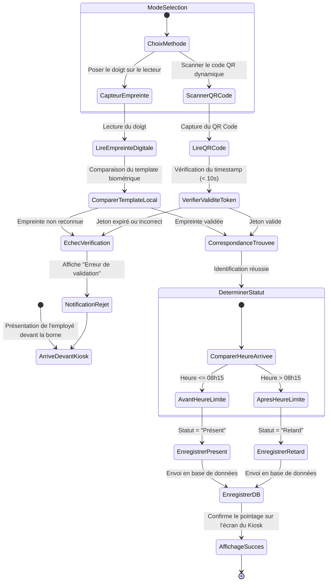

---

## II. Analyse détaillée

### 3. Diagramme de séquence (Sequence Diagram)
Montre le processus chronologique d'authentification biométrique par empreinte digitale sur la borne Kiosk.

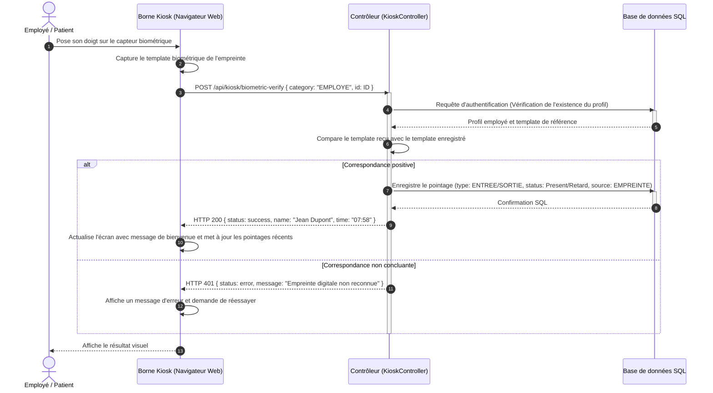

---

### 4. Diagramme de collaboration/communication
Illustre l'échange de messages structurels entre les composants lors d'une vérification d'empreinte digitale sur le Kiosk.

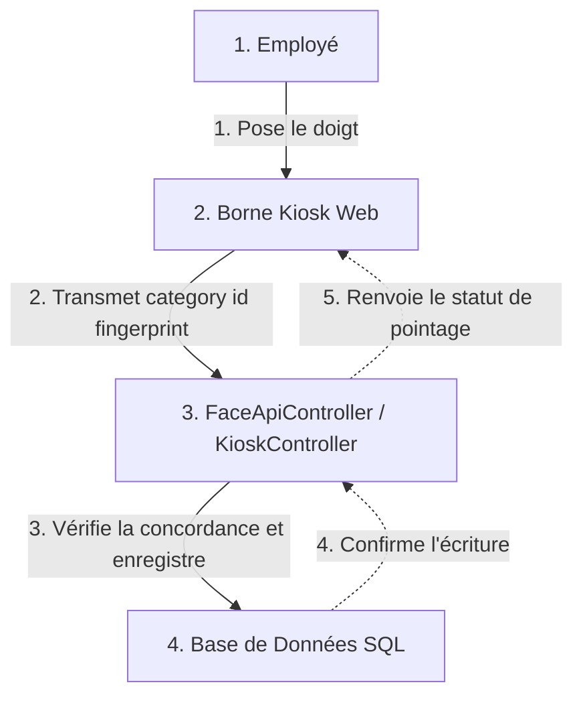

---

### 5. Diagramme d'état-transition (State Machine Diagram)

#### État de l'Employé au sein de l'hôpital
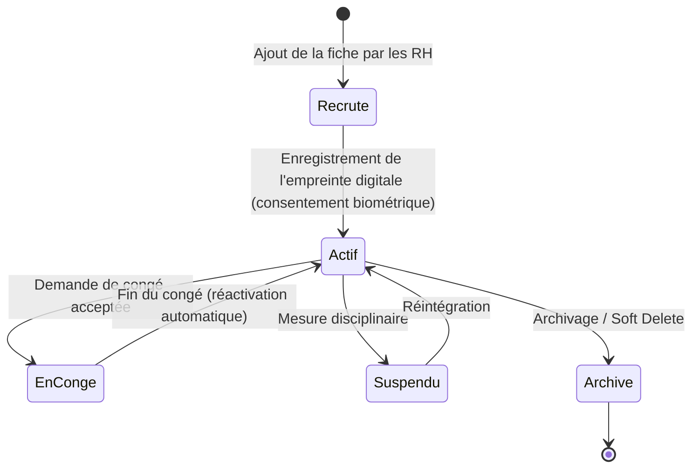

#### État d'un Pointage
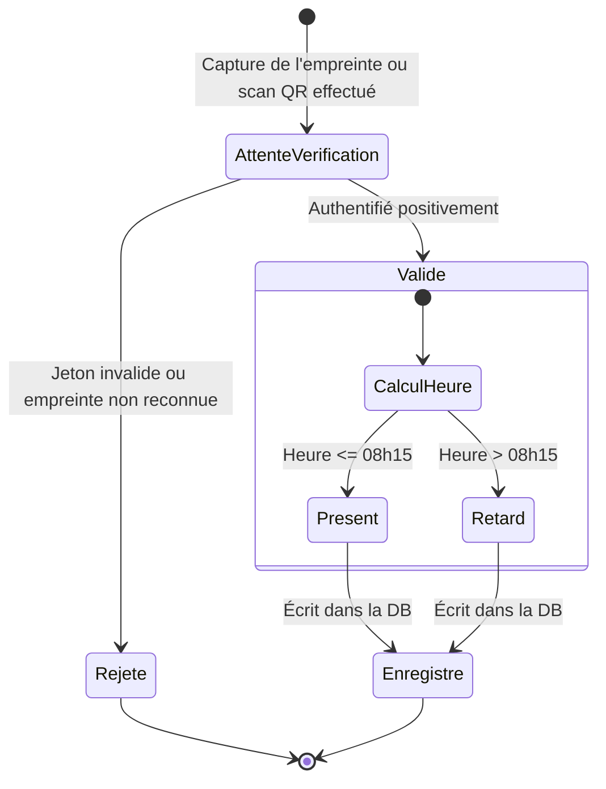

---

### 6. Diagramme d'activité de validation des congés (Workflow Diagram)
Représente le flux de traitement administratif d'une demande de congé ou d'autorisation d'absence par le service RH.

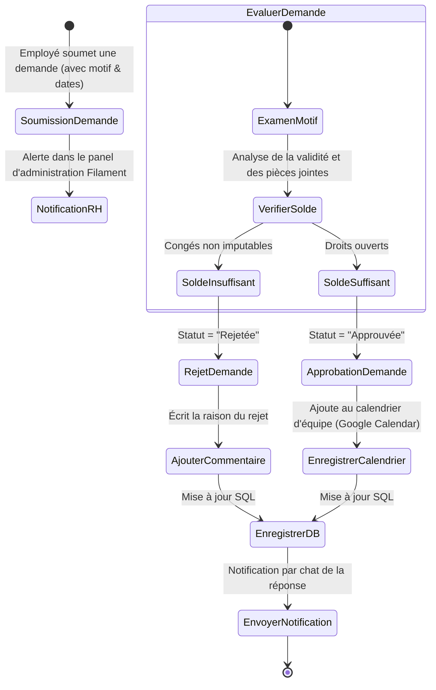

---

## III. Conception architecturale

### 7. Diagramme de composants (Component Diagram)
Montre l'organisation modulaire de l'application et les points d'intégration avec les APIs tierces.

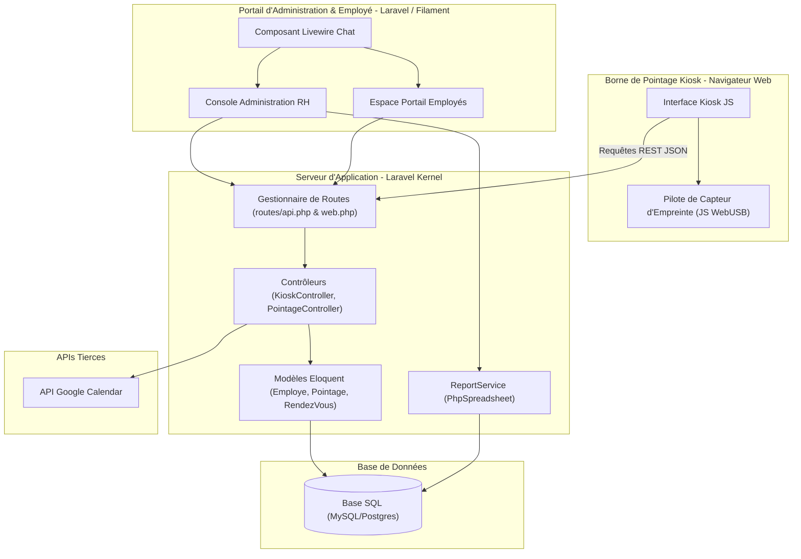

---

### 8. Diagramme de déploiement (Deployment Diagram)
Décrit l'architecture physique du système (tablette Kiosk, serveur Web et APIs Cloud).

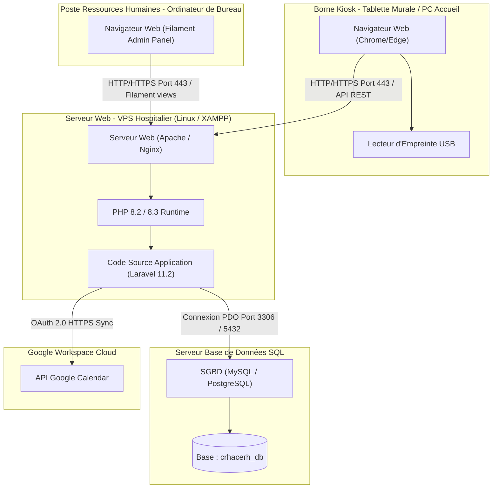

---

### 9. Diagramme de paquetages (Package Diagram)
Montre le découpage logique des modules de l'application Laravel/Filament.

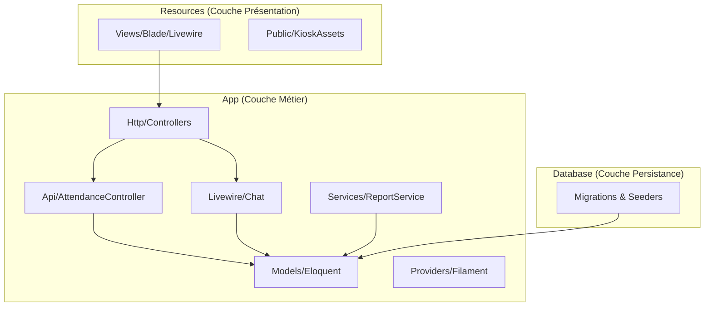

---

## IV. Conception détaillée

### 10. Diagramme de classes détaillé (Class Diagram)
Contient la structure des données avec leurs attributs, leurs types et les relations d'association.

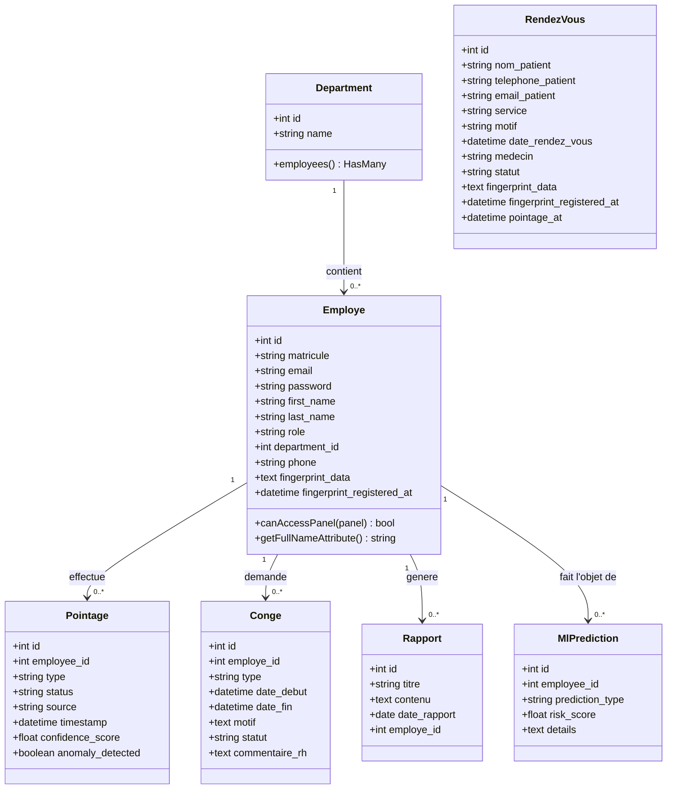

---

### 11. Diagramme d'objets (Object Diagram)
Instance concrète représentant le pointage biométrique d'un employé et l'arrivée d'un patient à un instant T.

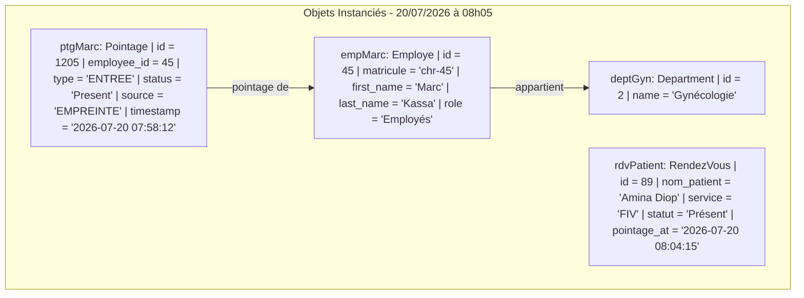

---

## V. Base de données et Interface

### 12. Dictionnaire de données

| Nom du champ | Description | Type | Contraintes |
| :--- | :--- | :--- | :--- |
| **employés.id** | Identifiant de l'employé | INT | Primary Key, Auto-incrément |
| **employés.matricule** | Matricule unique de l'employé | VARCHAR(50) | Unique, Obligatoire |
| **employés.email** | Email professionnel de l'employé | VARCHAR(150) | Unique, Obligatoire |
| **employés.password** | Mot de passe sécurisé | VARCHAR(255) | Haché en base |
| **employés.first_name** | Prénom de l'employé | VARCHAR(100) | Obligatoire |
| **employés.last_name** | Nom de famille de l'employé | VARCHAR(100) | Obligatoire |
| **employés.role** | Rôle d'accès | VARCHAR(50) | `RH_Admin`, `Manager`, `Employés` |
| **employés.fingerprint_data**| Template de l'empreinte digitale | TEXT | Optionnel |
| **employés.fingerprint_registered_at**| Date d'enregistrement d'empreinte | TIMESTAMP | Optionnel |
| **pointages.id** | Identifiant unique du pointage | INT | Primary Key |
| **pointages.employee_id** | Clé étrangère vers l'employé | INT | Foreign Key, Cascade |
| **pointages.type** | Type de pointage | VARCHAR(20) | `ENTREE`, `SORTIE` |
| **pointages.status** | Statut calculé | VARCHAR(20) | `Present`, `Retard`, `Absent` |
| **pointages.source** | Source d'enregistrement | VARCHAR(20) | `EMPREINTE`, `QR` |
| **rendez_vous.id** | Identifiant unique du rendez-vous | INT | Primary Key |
| **rendez_vous.nom_patient** | Nom et prénom du patient | VARCHAR(150) | Obligatoire |
| **rendez_vous.statut** | Statut du rendez-vous | VARCHAR(50) | `Planifié`, `Présent`, `Réalisé`, etc. |
| **conges.id** | Identifiant unique de la demande | INT | Primary Key |
| **conges.statut** | Statut de validation | VARCHAR(50) | `En attente`, `Approuvée`, `Rejetée` |

---

### 13. Schéma relationnel (MCL)
*   **departments** (<u>id</u>, name, created_at, updated_at)
*   **employés** (<u>id</u>, matricule, email, password, first_name, last_name, role, phone, fingerprint_data, fingerprint_registered_at, created_at, updated_at, deleted_at, *department_id#*)
*   **pointages** (<u>id</u>, type, status, source, timestamp, confidence_score, anomaly_detected, created_at, updated_at, *employee_id#*)
*   **rendez_vous** (<u>id</u>, nom_patient, telephone_patient, email_patient, service, motif, date_rendez_vous, medecin, statut, fingerprint_data, fingerprint_registered_at, pointage_at, created_at, updated_at)
*   **conges** (<u>id</u>, type, date_debut, date_fin, motif, statut, commentaire_rh, created_at, updated_at, *employe_id#*)
*   **rapports** (<u>id</u>, titre, contenu, date_rapport, created_at, updated_at, *employe_id#*)
*   **ml_predictions** (<u>id</u>, prediction_type, risk_score, details, created_at, *employee_id#*)

---

### 14. Schéma physique (ERD)

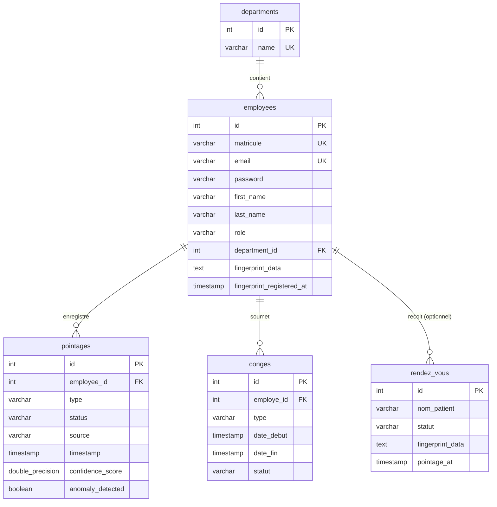

---

### 15. Diagrammes d'interface utilisateur (Maquettes/wireframes)

#### Borne Interactive Kiosk (Écran Public d'accueil)
```text
+-------------------------------------------------------------------------------+
| [Logo CHRACERH]              BORNE DE POINTAGE             20/07/2026 12:00   |
+-------------------------------------------------------------------------------+
|  [ Onglet 1: Employés ]   |   [ Onglet 2: Patients ]   |  [ Onglet 3: Biométrie ]|
+---------------------------+----------------------------+----------------------+
|                           |  +----------------------+  |  +-----------------+ |
|  Posez votre doigt sur    |  | Rendez-vous du Jour  |  |  | Enregistrement  | |
|  le capteur biométrique   |  |                      |  |  | d'Empreinte     | |
|  pour enregistrer votre   |  | - 08:30 Amina Diop   |  |  |                 | |
|  pointage d'arrivée       |  | - 09:15 Paul Kassa   |  |  | [Formulaire]    | |
|                           |  |                      |  |  |                 | |
|  [Lecteur d'Empreinte]    |  +----------------------+  |  +-----------------+ |
|                           |                            |                      |
|  Pointages Récents :      |  Arrivés récents :         |                      |
|  - Marc Kassa (07:58)     |  - Amina Diop (08:04)      |                      |
+-------------------------------------------------------------------------------+
```

#### Portail RH Admin (Filament Dashboard)
```text
+-------------------------------------------------------------------------------+
|  Menu: (x) Tableau de bord  |  ( ) Employés  |  ( ) Rendez-vous  | ( ) Congés |
+-------------------------------------------------------------------------------+
|  +--------------------+  +--------------------+  +-------------------------+  |
|  | Présents Jour : 42  |  | Retards Jour : 3   |  | Absents Jour : 5        |  |
|  +--------------------+  +--------------------+  +-------------------------+  |
|                                                                               |
|  Graphique d'Assiduité de la Semaine (Presents, Retards, Absents)             |
|  [====================== Chart.js Line Chart ===========================]    |
|                                                                               |
|  Activités Récentes :                                                         |
|  - Marc Kassa (07:58 - Entrée par Empreinte Digitale)                         |
+-------------------------------------------------------------------------------+
```

---

### 16. Architecture MVC de l'Application Web

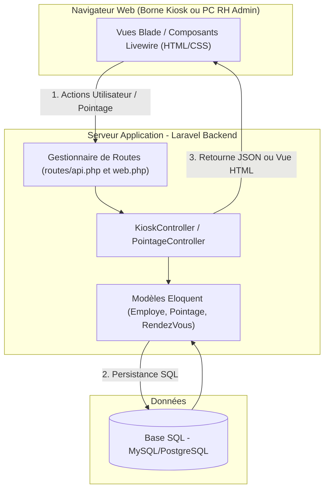
